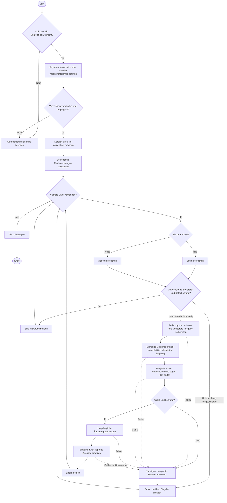

# Umsetzungsplan: Pipeline ohne Backups

Stand: 16. Oktober 2026. Status: implementiert und durch denselben Lead-Agent geprüft.
Nachweise und bekannte Grenzen: [Abnahmebericht](report.md).
Geprüfter Ausgangspunkt: `main`, Commit `8867f57288d9d1bd74751dfd4d4e84b649e479c9` (`chore: update to node26 overall`).

Dieser Plan ist die Übergabe für eine frische Session. Er ist kein Spec-Kit-Workflow. Ältere Dokumente unter
`specs/001-media-cli` und `specs/002-video-processing-rules` sind historische Entwurfsstände. Bei Widersprüchen zur
hier vereinbarten Ablauflogik gilt dieser Plan; für die beibehaltene technische Verarbeitung gilt der aktuelle Code.

- [Abnahme und Testfälle](acceptance.md)
- [Startprompt und Agent-Empfehlung](kickoff.md)

## 1. Ziel und verbindliche Grenze

Die Entscheidung über eine Verarbeitung hängt ausschließlich vom untersuchten Zustand einer Datei ab, nicht von
Backups, Herkunftsmarkierungen, Zeitstempelvergleichen oder einem früheren Verarbeitungslauf. Eine erfolgreich
verarbeitete Datei muss beim nächsten Lauf ohne weitere Schreibzugriffe übersprungen werden.

Dieses Paket ändert die Ablaufsteuerung und Dateisicherheit. Die technischen Medienoperationen bleiben erhalten.
Keine JXL-Umstellung, keine neuen Codecs oder Container, keine neuen Qualitätsparameter und keine Formatumbenennung.

### Enthalten

- Ein Verzeichnis, nur unmittelbar enthaltene Dateien, Auswahl anhand der bestehenden Endungs-Whitelist.
- Zustandsprüfung vor der Verarbeitung für Bilder und Videos; Skip mit sichtbarer Begründung bei Konformität.
- Vollständige Entfernung der aktiven Backup-Verwaltung und Backup-basierten Auswahl.
- Temporäre Ausgaben, Prüfung vor Übernahme, sichere Ersetzung unter demselben Dateinamen.
- Erhalt der ursprünglichen Änderungszeit bei erfolgreich verarbeiteten Dateien.
- Verständliche Fortschrittsmeldungen, Fehler pro Datei und abschließender Report.
- Echte Medienintegrationstests, insbesondere unveränderter zweiter Lauf und Fehlerfälle.
- Anpassung der aktuellen Anwender- und Entwicklerdokumentation an das neue Verhalten.

### Nicht enthalten

- JPEG XL als Ein- oder Ausgabeformat und Installation zusätzlicher JXL-Werkzeuge.
- Eigenständige Audiodateien oder neue Anforderungen an Audiospuren in Videos.
- Neue Abmessungen, Bitraten, Bildraten, Codecs, Qualitätswerte oder Container.
- Die besprochene Metadaten-Positivliste zum Erhalt von GPS, Aufnahmedatum und Darstellungsinformationen.
- Neue Verarbeitungspfade wie Metadaten-only-Remuxing, selektives Audiotranscoding oder Encoder-Optimierungen.
- Formatbedingte Umbenennungen, ein generisches Zielprofil-System oder vorsorgliche Plug-in-Architektur.
- Neue Flags wie `--verbose`, rekursive Verarbeitung, parallele Medienverarbeitung oder Wiederaufnahme-Datenbanken.
- Migration, Reinigung, Wiederherstellung oder Löschung vorhandener `.originals`-Verzeichnisse.

## 2. Technische Verarbeitung, die erhalten bleibt

| Bereich | Verbindlicher Ausgangsstand |
| --- | --- |
| Bildendungen | `.png`, `.jpg`, `.jpeg`, `.gif`, `.webp`; Erkennung ohne Beachtung der Großschreibung |
| Bildausgabe | Eingabeformat, Dateiname und Endung bleiben erhalten |
| Bildoperation | ImageMagick `mogrify`, Metadaten-Stripping und Resize auf höchstens `1200x1200`, ohne Upscaling |
| Videoendungen | `.mp4`, `.mov`, `.m4v`, `.mkv`, `.avi` |
| Videoausgabe | Dateiname und Endung bleiben erhalten; kein erzwungener MP4-Container |
| Videocodec | H.264 über `libx264`, CRF 23, Preset `slow` |
| Videoabmessungen | Maximal 1280 × 720 im Querformat oder 720 × 1280 im Hochformat |
| Skalierung | Seitenverhältnis erhalten, keine Vergrößerung, bestehende Abrundung auf gerade Videodimensionen |
| Bildrate | Höchstens 24 fps; bestehende niedrigere Bildrate erhalten |
| Ton in Videos | Vorhandene Audiospuren kopieren; keine neue Codec- oder Bitratenvorgabe |
| Untertitel | Bestehende Textuntertitel-Übernahme; bisherige Behandlung von Binär-, Daten- und Anhangsspuren |
| Videometadaten | Bestehende FFmpeg-Metadaten- und Kapitelentfernung |
| Containeroptionen | Bestehendes `+faststart` für `.mp4`, `.m4v`, `.mov` |

Limits bleiben zentral in `src/media/constants.ts`. CRF und Preset sind Encoder-Einstellungen, keine nachträglich
zu erratenden Konformitätsmerkmale fremder Dateien. Ein bereits konformes Video darf unabhängig von seinem Encoder
übersprungen werden. Dateiendungen dienen der Auswahl; tatsächliche Lesbarkeit und Inhalte werden untersucht.

Ein bereits heute unverträglicher Container-/Stream-Fall darf nicht durch einen stillen Formatwechsel repariert werden.
Schlägt die Verarbeitung oder ihre Prüfung fehl, bleibt die Eingabe erhalten und die nächste Datei wird bearbeitet.

## 3. Ausgangscode und Änderungsstellen

| Datei | Ausgangsverhalten und notwendige Änderung |
| --- | --- |
| `src/index.ts` | Nimmt bisher nur das erste Argument; höchstens ein Verzeichnisargument sauber validieren |
| `src/cli.ts` | Verzeichnisprüfung und Ausgabe; Backup-Ankündigung entfernen, Skip-/Fehlergründe zeigen |
| `src/media/filesystem.ts` | Filtert bisher vorhandene Backups aus; nur Verzeichnis- und Medienauswahl behalten |
| `src/media/constants.ts` | `ORIGINALS_DIR` entfernen; technische Medienkonstanten und Whitelists erhalten |
| `src/media/processor.ts` | Backup, Restore und Bild-In-place-Schreiben durch sichere Übernahme ersetzen |
| `src/media/inspect.ts` | Bestehende Videoentscheidung erhalten und für die Ausgabeprüfung wiederverwenden |
| `src/media/types.ts` | Zustands-, Entscheidungs- und Ergebnisdaten bei Bedarf gezielt erweitern |
| `src/adapters/mogrify.ts` | Bestehende Operation nur auf einer eigenen temporären Bildkopie ausführen |
| `src/adapters/ffmpeg.ts` | Bestehende Operation auf eindeutige temporäre Ausgabe ausführen |
| `src/adapters/ffprobe.ts` | Bestehende Videoinspektion und technische Tag-Ausnahmen berücksichtigen |
| Neuer Bildprüfadapter | ImageMagick-Inspektion mit typisiertem Ergebnis; keine Shell-Befehle im Medienkern |

Bildinspektion und gemeinsame Dateitransaktion dürfen kleine eigene Module bekommen. Keine große Hierarchie aus
abstrakten Prozessoren: zwei Medienarten und ein gemeinsamer sicherer Ablauf reichen für dieses Paket.

Heute gibt es noch keine Bild-Konformitätsprüfung. Bilder werden unabhängig von ihrer Größe mit `mogrify`
bearbeitet,
sofern kein Backup sie herausfiltert. Videos haben bereits eine inhaltsbasierte Entscheidung. Die Videoausgabe wird
derzeit als vorhersehbares `<basename>.tmp<extension>` geschrieben; dieser Name kann mit fremden Dateien kollidieren.

Die aktuelle `AGENTS.md` fordert Backups. Roland hat die Entfernung ausdrücklich beschlossen. In der Umsetzung die
Regel durch temporäre, geprüfte Ausgabe und Benutzerverantwortung für Originale ersetzen; keine erneute
Freigabe nötig.

Node.js 26 ist die verbindliche Runtime und bereits als Default installiert. Node und npm aus `~/.n/bin` verwenden.
Lokal geprüft: Node 26.11.1 und npm 11.20.0. Beim Start der Umsetzung die effektiven Versionen erneut dokumentieren.
Das separat konfigurierte Build-Ziel in `tsdown.config.ts` wurde auf `node26` angehoben und bleibt so erhalten.
Der Dependency-Stand enthält TypeScript 7.0.2, `@types/node` 26.6.4, Biome 2.5.15 und Vitest 5.0.3.
`tsconfig.json` erweitert `@tsconfig/node26` 26.0.1 und setzt lokal ausschließlich `noEmit: true`.
Node-Typen kommen aus dem Preset; `strict` ist mit TypeScript 7 standardmäßig aktiv. Ohne explizites `include` werden
weiterhin alle 22 bisherigen TypeScript-Projektdateien erfasst, einschließlich Tests und Tool-Konfigurationen.
Effektiv gelten `target: es2025`, `module: nodenext` und `moduleResolution: nodenext`; tsdown erzeugt die Ausgabe.
Diese Konfiguration und die Abhängigkeiten im Pipeline-Paket beibehalten. Keine zusätzliche Toolchain-Migration,
keine eigenmächtigen Upgrades oder Downgrades und kein Wechsel zurück auf ältere Node-Presets oder Build-Ziele.

## 4. Ablauf dieses Pakets

Der allgemeinere Gesprächsentwurf enthielt Ton, Formatwechsel und eine abschließende Positivlisten-Bereinigung.
Diese Äste sind hier absichtlich nicht implementiert. Das vorhandene Stripping bleibt Teil der bisherigen Operation.

### Auswahl und Aufruf

- Kein Positionsargument: `process.cwd()`. Genau eines: dieses Verzeichnis. Mehr als eines: verständlicher
  Aufruffehler.
- Nicht implementierte Flags nicht als Verzeichnis interpretieren oder still ignorieren. Keine neue
  Flag-Funktion nötig.
- Dateiauswahl nicht anhand von `.originals` reduzieren. Der Unterordner wird genauso wenig betreten wie jeder andere.
- Einen Snapshot der Eingaben vor dem Erzeugen temporärer Dateien verwenden und Dateien nacheinander verarbeiten.
- Nur reguläre Dateien im gewählten Verzeichnis bearbeiten; Symlinks nicht in fremde Verzeichnisse verfolgen.
- Leeres Verzeichnis und ausschließlich nicht unterstützte Dateien: erfolgreicher Abschluss ohne Änderungen.

### Untersuchung und Entscheidung

- Bilder auf tatsächliches Format, Abmessungen und relevante, vom bisherigen Stripping entfernte Metadaten prüfen.
  Bei Animationen alle relevanten Frames/Canvas-Abmessungen berücksichtigen; keine Reduktion auf das erste Einzelbild.
- Für Bildmetadaten eine kleine, anhand realer Tool-Ausgaben belegte Unterscheidung zwischen entfernbaren Metadaten
  und unvermeidbarer technischer Struktur implementieren. Keine fachliche GPS-/Datum-Positivliste vorwegnehmen.
- Videoentscheidung einschließlich bestehender Metadaten-Ausnahmen beibehalten. Aktuell ignoriert der Probe-Adapter
  auf Formatebene `major_brand`, `minor_version`, `compatible_brands`, `encoder` und auf Streamebene `language`,
  `handler_name`, `vendor_id`, `encoder`. Das ist keine neue fachliche Positivliste.
- Fehlende oder ungültige essentielle Probe-Daten nicht als Konformität behandeln. Fehler melden statt blind ersetzen.
- Die Prüfung darf nicht zum Erkennen eines Skips vorsorglich eine weitere verlustbehaftete Datei kodieren.
- Ein konformer Skip erzeugt keine Ausgabe und verändert weder Dateibytes noch Änderungszeit.
- Jeder ausgewählte Kandidat erhält ein nachvollziehbares Ergebnis; ein Fehler stoppt nicht die übrigen Dateien.

### Sichere Dateitransaktion

1. Quelle und ursprüngliche Änderungszeit erfassen. Eingabe nie als Ausgabe eines schreibenden Medientools verwenden.
2. Einen eindeutig und exklusiv reservierten temporären Dateinamen im selben Verzeichnis verwenden. Die passende
   Medienendung erhalten, damit die bisherige Formatauswahl funktioniert. Keine fremden `.tmp`-Dateien überschreiben.
3. Für Bilder die Quelle in diese temporäre Datei kopieren und `mogrify` auf der Kopie ausführen. Für Videos FFmpeg
   auf die reservierte temporäre Ausgabe schreiben lassen. Kein zweiter Neukodierungsdurchlauf zur Bereinigung.
4. Ausgabe prüfen: vorhanden, nicht leer, lesbar, konform und zum erwarteten Verarbeitungsergebnis passend.
   Dieselbe Konformitätsentscheidung wie beim Eingang verwenden, zusätzlich die Erhaltungspflichten des Plans prüfen.
5. Änderungszeit der Quelle auf die Ausgabe übertragen. Das ist Dateisystem-mtime, kein EXIF-Aufnahmedatum.
   Die erreichbare Zeitstempelpräzision dokumentieren; keine Behauptung nanosekundengenauer Erhaltung ohne Test.
6. Geprüfte Ausgabe im selben Dateisystem per Rename unter dem ursprünglichen Namen übernehmen. Quelle vorher nicht
   löschen. Dateinamen, Endungen und Containerpolitik bleiben unverändert.
7. Bei Fehlern vor der Übernahme nur eigene temporäre Artefakte entfernen. Quelle nicht aus Backups zurückkopieren.
   Nach erfolgreicher Übernahme darf ein späterer Reporting-Fehler die fertige Datei nicht löschen.

Metadaten-Stripping kann die mtime verändern, deshalb deren Übertragung erst nach dem letzten Medien-Schreibzugriff.
Die Prüfung nach der Verarbeitung muss auch verlorene erwartete Audiospuren, Textuntertitel oder Animationsframes
erkennen können. Reine Einhaltung der Maximalmaße genügt nicht als vollständige Ausgabevalidierung.

Behandelbare Abbrüche und Fehler sollen eigene temporäre Dateien aufräumen. Für SIGKILL/Stromausfall keine
vollständige
Bereinigung versprechen; mögliche temporäre Reste dokumentieren und nicht pauschal fremde Dateien löschen.
Gleichzeitige Läufe oder externe Bearbeitung desselben Verzeichnisses sind kein zugesicherter Betriebsmodus.

### Ausgabe und Dokumentation

- `processed`, `skipped`, `failed` als vorhandene Ergebnisstruktur möglichst weiterverwenden.
- Skip-Grund `compliant`, konkrete Verarbeitungsgründe und Fehlerphase verständlich ausgeben.
- Abschlusszahlen und Dateilisten müssen alle ausgewählten Eingaben korrekt abdecken.
- Bestehendes Verhalten bei fatalen Verzeichnis-/Toolfehlern erhalten; Exit-Code-Verhalten vor Änderungen prüfen.
- Keine Backup-Ankündigung, `backup-exists`-Entscheidung, Backup-Pfade oder Restore-Funktion mehr im aktiven Ablauf.
- README erklärt ausdrücklich: keine Backups; Originale bei Bedarf vorher selbst an anderer Stelle sichern.
- Historische Specs nicht umschreiben. Negative Tests auf unberührte `.originals`-Ordner bleiben ausdrücklich
  sinnvoll.

## 5. Umsetzungsreihenfolge

1. **Ausgangslage prüfen:** Checkout, Arbeitsbaum, Regeln und installierte Tools lesen. Bestehende Checks als Baseline
   ausführen. Bereits vorhandene Fehler von später eingeführten Regressionen trennen.
2. **Konformität und Prüfverträge festlegen:** Videoentscheidung weiterverwenden, Bildinspektion ergänzen. Mit
   kleinen
   echten Dateien die Metadaten-Ausgaben vor/nach der aktuellen Operation charakterisieren. Testfälle aus
   `acceptance.md` auf konkrete Fixtures abbilden. Keine produktiven Medienverzeichnisse für Experimente verwenden.
3. **Gemeinsame sichere Verarbeitung bauen:** Temporärdateien, Validierung, mtime, Übernahme und gezieltes Cleanup.
   Adapter dürfen nur temporäre Ausgaben ändern. Verlust der Eingabe bei Fehlern durch gezielte Tests ausschließen.
4. **Backup-Logik entfernen und CLI anschließen:** Discovery, Prozessor, Typen, Konstanten und Meldungen gemeinsam
   umstellen. Bestehende Tests für Backup/Restore durch Tests der neuen Verträge ersetzen; Assertions nicht
   nur löschen.
5. **Dokumentation aktualisieren:** README und `AGENTS.md` einschließlich aufgehobener Backup-Pflicht anpassen.
   Die Grenzen dieses Pakets in Specs erhalten; keine JXL-/Audio-/Video-Profilentscheidung hinzufügen.
6. **Abnehmen:** Unit-, Integrations- und echte CLI-Läufe aus `acceptance.md`, dann die verpflichtenden Projektchecks.
   Ergebnisse, Toolversionen und verbleibende Einschränkungen konkret dokumentieren.

## 6. Offene Umsetzungspunkte und Abbruchgrenzen

Keine weitere Produktentscheidung ist für den Start erforderlich. Bild-Metadateninspektion, Zeitstempelpräzision und
konkrete Fixture-Auswahl sind zu untersuchende Implementierungsdetails, keine pauschalen Freigabestufen.

Wenn das bestehende Medienwerkzeug trotz korrekter Orchestrierung kein konformes Ergebnis liefern kann, muss die
Ausgabeprüfung die Übernahme verhindern. Nicht die Prüfregeln abschwächen oder ungefragt neue Formate einführen.
Den konkreten Fall reproduzierbar dokumentieren; eine notwendige Änderung der Medienpolitik separat abstimmen.

Die frühere Regel für spätere Formatwechsel bleibt als Kontext erhalten: vollständigen Eingabenamen um Zielendung
ergänzen, falls sie nicht bereits vorliegt; `foto.jpg` wird `foto.jpg.jxl`. Bei belegtem Ziel alle betroffenen Dateien
warnend überspringen. Hier ist Ausgabeziel gleich Eingabepfad, daher keinen ungenutzten Umbenennungszweig entwickeln.

## 7. Arbeitsweise und Abschluss

Ein Lead-Agent setzt das Paket vollständig um und prüft es. Keine parallelen schreibenden Subagents: Die wichtigsten
Änderungen betreffen gemeinsam Prozessor, Typen, Adapterverträge und deren Tests. Eine separate unabhängige Prüfung
kann später auf einem unveränderten Stand erfolgen, ist aber kein Pflichtteil oder versteckter zusätzlicher Auftrag.

Keine Commits, Pushes, Releases oder Veröffentlichungen ohne ausdrücklichen Auftrag. Bestehende fremde Änderungen
erhalten. Im Abschluss geändertes Verhalten, relevante Dateien, tatsächlich ausgeführte Tests und Einschränkungen
nennen. Implementierung erst bei erfüllten Abnahmekriterien als abgeschlossen bezeichnen.
